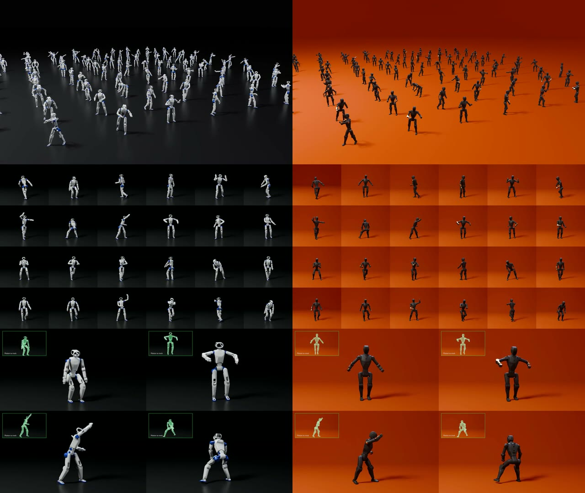

# Cartwheel Control

<!-- hero video -->
<a href="https://huggingface.co/andrew-cartwheel/cartwheel-control/resolve/main/assets/cartwheel-control.mp4"></a>

Whole-body motion-tracking policies for humanoid robots. Give a policy a reference motion and it
drives the robot's joints to perform it, in physics simulation. Policies are released for two
robots:

| Robot | Joints | Weights |
|---|---|---|
| RoboParty RP1 | 28 | [`rp1/`](https://huggingface.co/andrew-cartwheel/cartwheel-control/tree/main/rp1) |
| Menlo Asimov-1 | 25 | [`asimov-1/`](https://huggingface.co/andrew-cartwheel/cartwheel-control/tree/main/asimov-1) |

## Run

Linux with an NVIDIA GPU, and [uv](https://docs.astral.sh/uv/) 0.6 or newer.

```bash
git clone https://github.com/Cartwhl/cartwheel-control && cd cartwheel-control
uv sync
uv run cartwheel-play --robot rp1
python -m http.server -d play_out/viewer 8000
```

Then open http://localhost:8000. `cartwheel-play` downloads the policy, the robot model and a set of
example motions from Hugging Face, simulates every motion at once, prints which ones the robot
completed, and writes a web viewer of the result: the robot as simulated, with the reference
motion as a translucent ghost.

| Option | |
|---|---|
| `--robot rp1` / `--robot asimov-1` | which policy |
| `--clips dance` | only motions whose name matches this regex |
| `--motions <folder>` | your own motions instead of the examples |
| `--max-seconds 20` | how much of each motion to run |
| `--out play_out` | output folder (`rollouts.npz` and `viewer/`) |

## Motions

A motion is a `.npz` file with `qpos`, an array of shape `(frames, 7 + joints)` at 50 Hz: root
position (m), root orientation (quaternion, w first), then joint angles (rad) in the order of the
robot's MJCF, also listed in its `config.json`. The robot starts in the motion's first frame.

## Layout

| | |
|---|---|
| `cartwheel_control/play.py` | the command line and the rollout loop |
| `cartwheel_control/policy.py` | network, observations and goal |
| `cartwheel_control/sim.py` | MuJoCo Warp simulation through [mjlab](https://github.com/mujocolab/mjlab) |
| `cartwheel_control/robots.py` | PD gains, action scales and default pose of each robot |
| `cartwheel_control/motion.py` | reference motions |
| `cartwheel_control/viewer.py`, `viewer.html` | the web viewer |

## License

Code is licensed under [Apache 2.0](LICENSE). Model weights are licensed under the [Cartwheel Open Model License](https://huggingface.co/andrew-cartwheel/cartwheel-control/blob/main/LICENSE).
The robot models are third-party and keep their own licenses: see
[NOTICE](https://huggingface.co/andrew-cartwheel/cartwheel-control/blob/main/NOTICE).
